# uz-open-data

Small, open datasets about Uzbekistan, each with the exact query or source it was built from: 2,289 mosques from OpenStreetMap and the Uzbek Cyrillic → 2026 Latin letter table.

[](https://scorecard.dev/viewer/?uri=github.com/wonmortech/uz-open-data)


**[Website](https://wonmor.io) · [Live demo](https://wonmor.io/demo/uz-open-data/) · [Post: Mosques from OpenStreetMap](https://wonmor.io/engineering/mosques-from-openstreetmap/)**

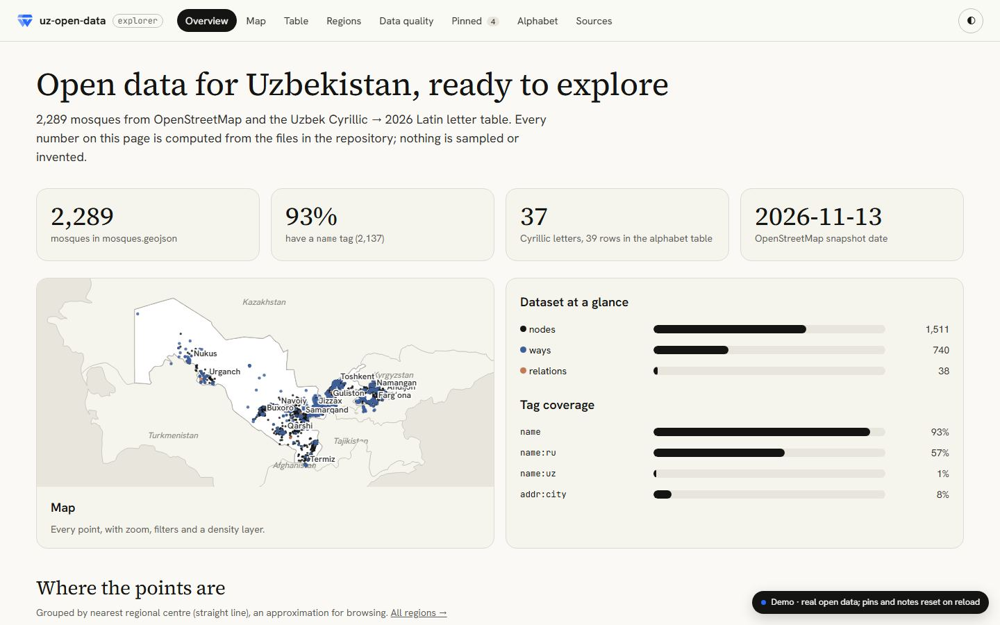

## What it does

- **Mosques as GeoJSON.** [`mosques/mosques.geojson`](mosques/) holds 2,289 points (1,511 nodes, 740 ways, 38 relations) tagged `amenity=place_of_worship` + `religion=muslim` inside Uzbekistan, snapshot of 2026-11-13.
- **Reproducible.** The Overpass query and a standard-library Python converter sit next to the data; one `curl` and one `python3` rebuild it.
- **Letter table.** [`alphabet/cyrillic-to-latin-2026.csv`](alphabet/) lists 39 rows for 37 Uzbek Cyrillic letters, transcribed from [bitg](https://github.com/dtwinuz/bitg), including the two context rules (е, ц).
- **Unchanged values.** Tags and letters are copied as they are in the source; corrections belong upstream.
- **Licence per folder.** OpenStreetMap data stays under the ODbL 1.0; code and the letter table are MIT.

The [live demo](https://wonmor.io/demo/uz-open-data/) is an explorer that loads these exact files in the browser: a map with filters and a density layer, a searchable table with CSV and GeoJSON export, per-mosque pages with nearest neighbours, a data-quality report and a live Cyrillic → 2026 Latin converter. No tiles, no backend, no third-party requests.

| | |
|---|---|
| 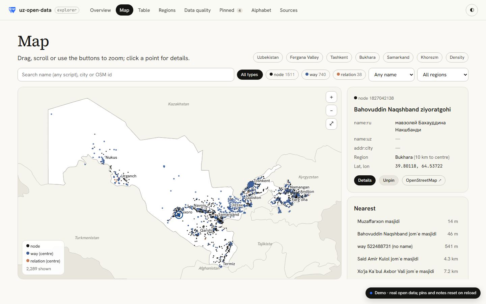 | 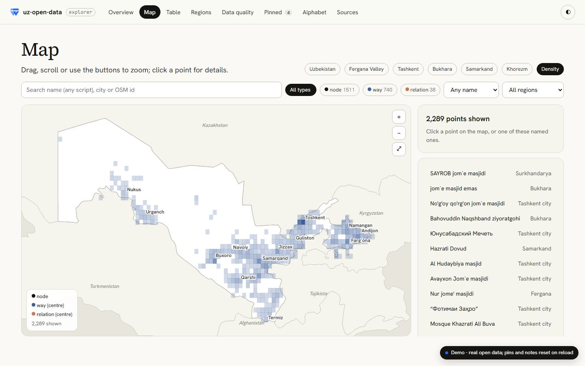 |
| **Map.** Every point by OSM type; click one for its tags and the nearest mosques. | **Density.** Where the mapped mosques cluster, from the Fergana Valley to Khorezm. |
| 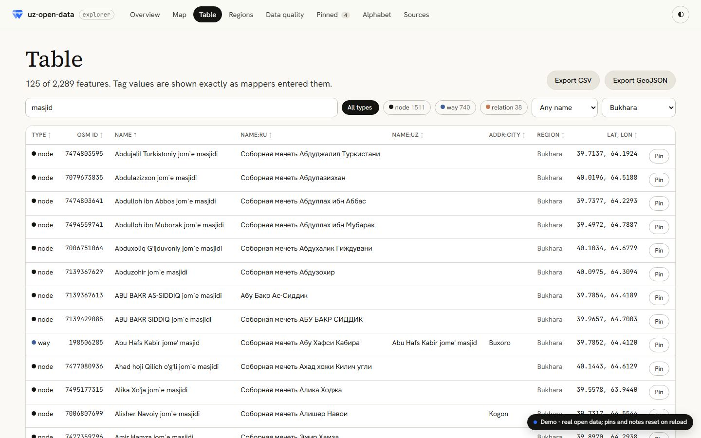 | 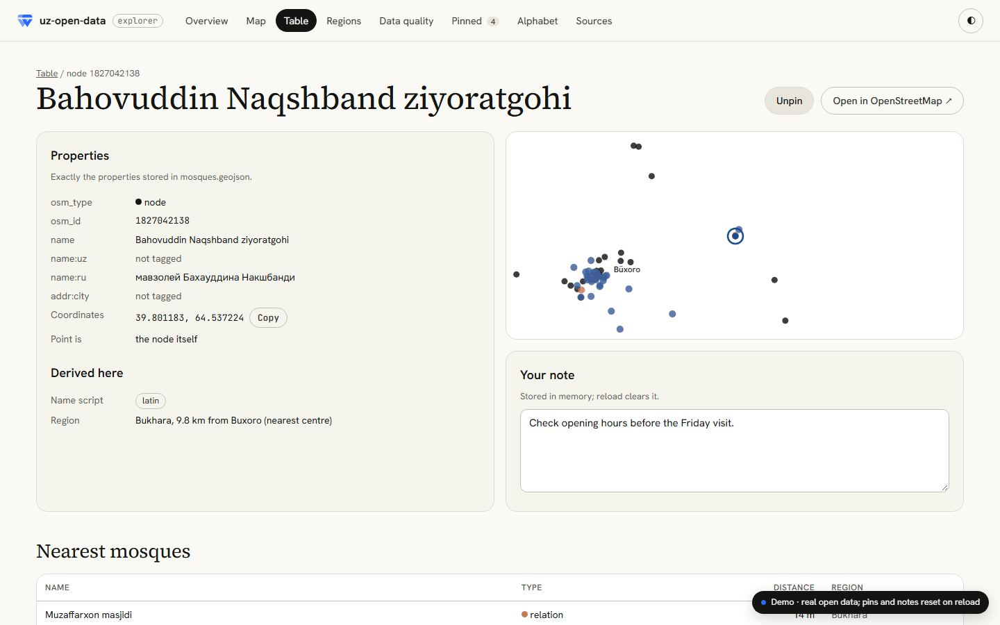 |
| **Table.** Search in Latin or Cyrillic (apostrophes ignored), filter, sort, export. | **Detail.** The stored properties, derived region, a mini map and a note. |
| 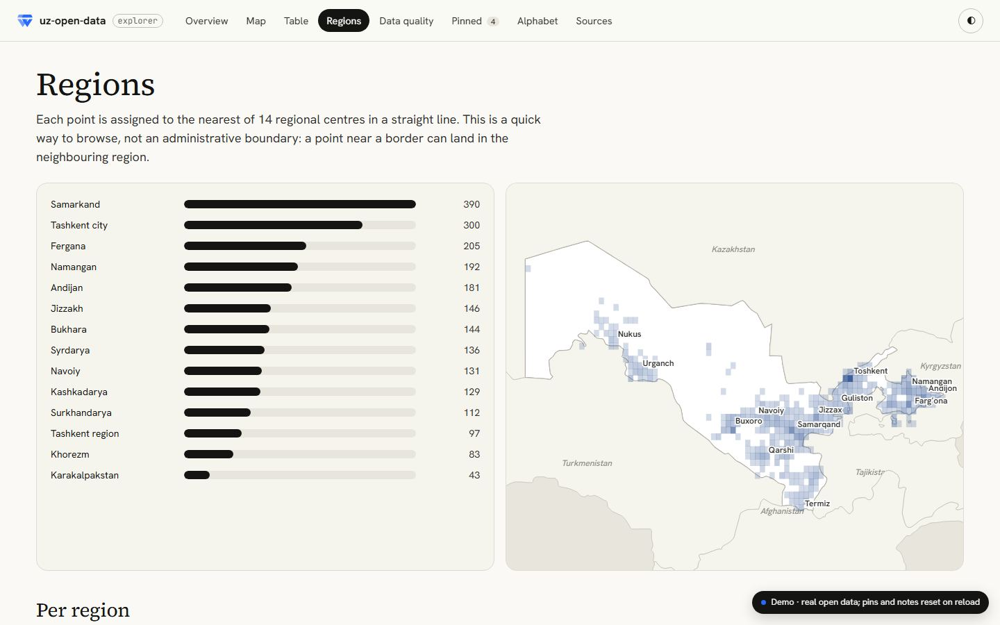 | 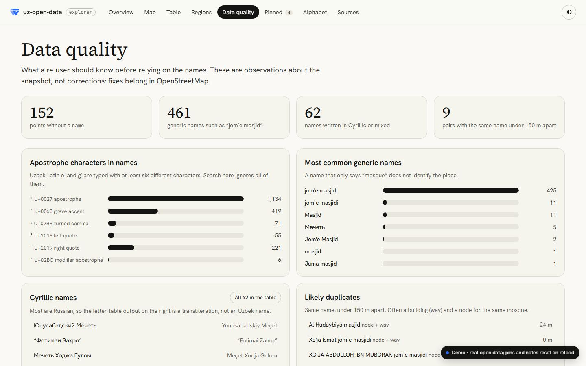 |
| **Regions.** Counts by nearest regional centre, an approximation for browsing. | **Data quality.** 152 unnamed, generic names, six apostrophe characters, likely duplicates. |
| 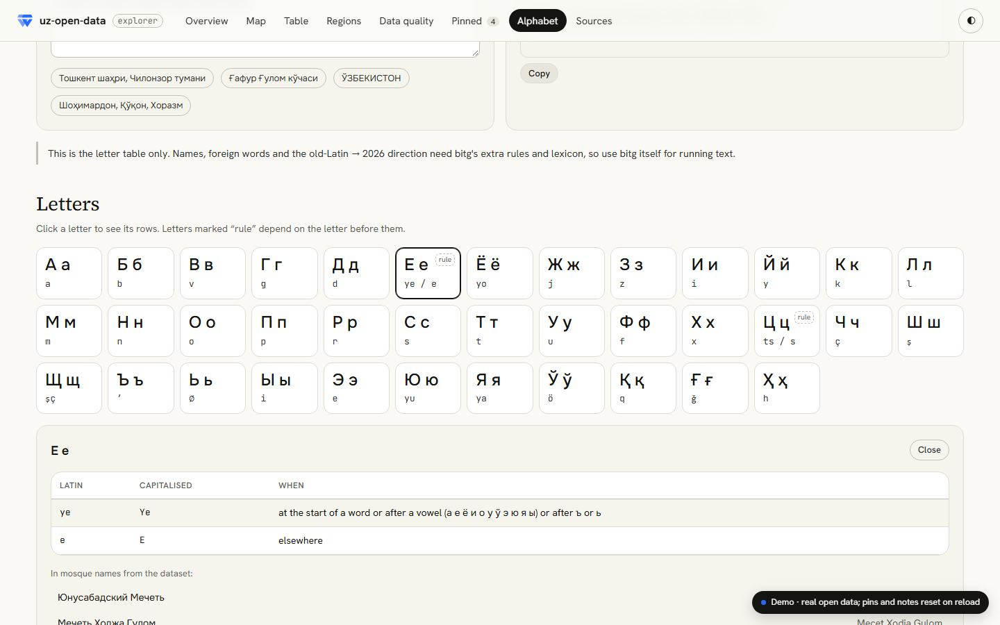 | 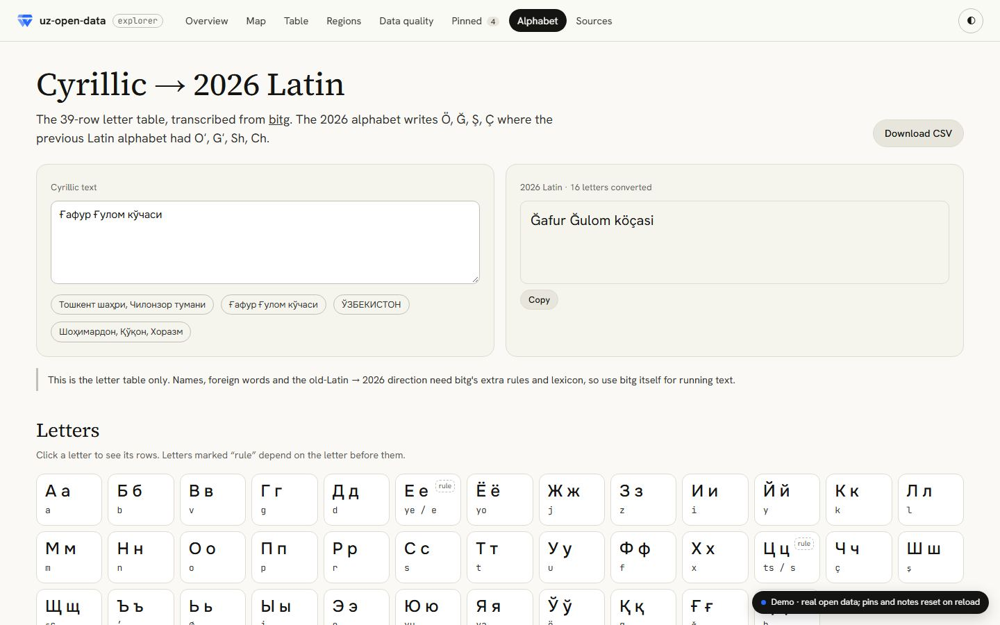 |
| **Alphabet.** Every letter and its rule, with examples from the dataset. | **Converter.** Letter-table conversion, checked against bitg's unit tests. |
| 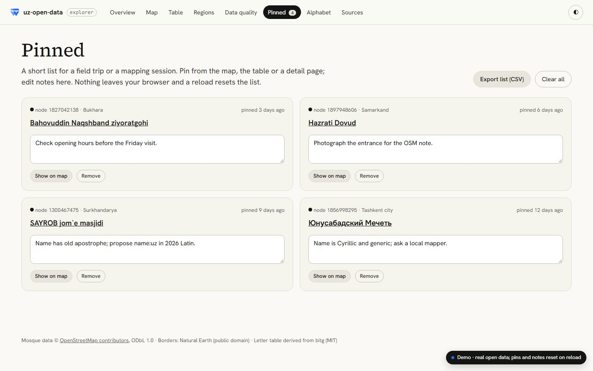 | 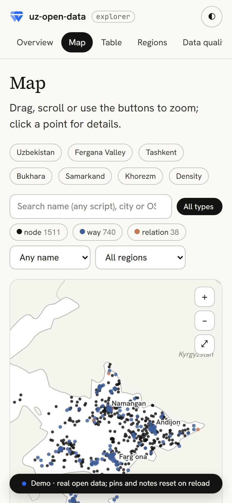 |
| **Pinned.** A short list with notes for a mapping trip; resets on reload. | **Phone.** The same explorer at 390 px. |

## Datasets

| Folder | What | Licence |
|---|---|---|
| [`mosques/`](mosques/) | 2,289 mosques from OpenStreetMap as GeoJSON points (snapshot 2026-11-13), the Overpass query and a converter | Data: **ODbL 1.0**, © OpenStreetMap contributors. Query and script: MIT |
| [`alphabet/`](alphabet/) | Uzbek Cyrillic → 2026 Latin letter table (CSV), transcribed from [bitg](https://github.com/dtwinuz/bitg) | MIT (derived from bitg, MIT OR Apache-2.0) |

Planned: Uzbek word lists. Nothing is published for them yet.

## Quick start

```bash
curl -sLO https://raw.githubusercontent.com/wonmortech/uz-open-data/main/mosques/mosques.geojson
```

Each feature is a `Point` (`[longitude, latitude]`, WGS 84) with `osm_type`, `osm_id` and, when tagged, `name`, `name:uz`, `name:ru`, `addr:city`. `https://www.openstreetmap.org/<osm_type>/<osm_id>` opens the object.

```python
import json
fc = json.load(open("mosques.geojson", encoding="utf-8"))
named = [f for f in fc["features"] if "name" in f["properties"]]
print(len(fc["features"]), len(named))   # 2289 2137
```

```bash
# rebuild from OpenStreetMap
cd mosques
curl -s https://overpass-api.de/api/interpreter --data-urlencode data@query.overpassql -o overpass.json
python3 to_geojson.py overpass.json mosques.geojson
```

The public Overpass servers are shared and sometimes answer 502 or 504; wait and retry rather than hammering them. For running text in Uzbek, use bitg itself: the letter table does not protect names or foreign words.

## Docs

- [`mosques/README.md`](mosques/README.md): snapshot timestamps, format, rebuild, attribution
- [`alphabet/README.md`](alphabet/README.md): columns, the е / ц / ъ / ь rules, case handling, source commit
- [`mosques/LICENSE-ODbL.md`](mosques/LICENSE-ODbL.md): what the ODbL asks of you

## Development

The datasets need no build. The explorer is plain HTML, CSS and JavaScript in [`demo/`](demo/); the build copies the datasets into it unchanged.

```bash
npm ci
npm run demo               # build to dist/demo/uz-open-data/ and serve on http://127.0.0.1:4290/demo/uz-open-data/
npm run test:demo          # Playwright smoke test: every page, filters, pins, converter against bitg's examples
npm run site:screenshots   # regenerate docs/screenshots/*.jpg
```

Map borders in the explorer come from Natural Earth 1:50m via world-atlas 2.0.2 (public domain).

## Licence

Unless a folder says otherwise, code and documentation are under the [MIT licence](LICENSE). The data in `mosques/mosques.geojson` is under the ODbL 1.0 (see [`mosques/LICENSE-ODbL.md`](mosques/LICENSE-ODbL.md)); if you use or redistribute it, keep the attribution "© OpenStreetMap contributors".
